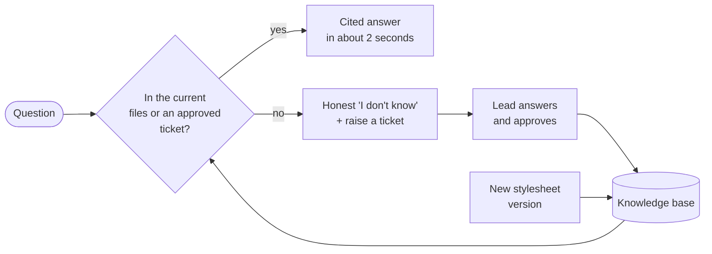

<div align="center">

# Resolve

### The institutional memory your publishing house never had.

Every editorial office runs on answers that live in one person's head.<br/>
Resolve captures them, keeps them current, and hands every colleague a **cited, trustworthy answer in two seconds**.

[The problem](#the-problem) · [What Resolve does](#what-resolve-does) · [A day with Resolve](#a-day-with-resolve) · [Proof](#proof-not-promises) · [Trust and privacy](#built-for-trust) · [Engineering](#the-engineering-behind-it) · [Run it](#run-it)

</div>

---

## The 30-second pitch

A publishing house is a machine for applying rules correctly, thousands of times: *this journal's reference style, that journal's embargo period, the revised stylesheet that took effect in March, the exception agreed for one manuscript.*

Those rules are written down in PDFs, Word files, email threads and old tickets, and the final authority is usually **one experienced person who remembers**. When they are on leave, in a meeting, or leave the company, the office slows down, guesses, or applies last year's rule.

Resolve turns that scattered memory into a system:

- **Ask** a question in plain language, get an answer with **citations to the exact passage**.
- Answers come **only from the latest revised files** and from **tickets a lead has approved**, never from a superseded stylesheet or an unchecked guess.
- Every journal is a **fence**: a question about one title can never surface another title's rules.
- If Resolve doesn't know, it **says so** and turns the question into a ticket. When the lead answers, the whole office knows the answer from then on.

It is a ticketing system that **teaches** a search engine, and a search engine that **cannot lie about its sources**.

---

## The problem

### The single point of failure

Ask any managing editor who answers the unusual questions. There is a name. Often one name per journal.

| Question that lands in the inbox | Who asks | Where the answer really is | What goes wrong today |
|---|---|---|---|
| "What is the embargo period before an accepted paper can be posted online?" | author, production | a policy PDF, plus a 2023 email exception | someone quotes last year's number |
| "How long may the abstract be?" | author, copyeditor | stylesheet v2 *and* a ticket that changed it | two colleagues give two answers |
| "Do we need a cover letter?" | author | a line in a guidelines document | the author waits two days for a reply |
| "Does this manuscript get the extended reference list agreed with the editor?" | production | one email thread, one ticket | the exception is forgotten at proofs |
| "Which stylesheet applies to a paper accepted before the revision?" | copyeditor | the revision's cover note | the new rules are applied retroactively |

### Why it keeps happening

1. **Knowledge is scattered across five places:** stylesheets, guidelines, email, tickets, and people's memory. No search box covers all of them.
2. **Rules change.** Stylesheets are revised; the old PDF is still in a shared folder, still ranks first in search, still gets quoted.
3. **Rules differ by title and by article.** What is true for one journal is wrong for the next, and an article can carry its own exception.
4. **The answer gets decided in a ticket or an email, then vanishes.** The same question comes back next month and costs the same effort again.
5. **Seniority becomes a bottleneck.** The person who knows is interrupted all day, and the office cannot grow without hiring another person who knows.

### What it costs (without inventing numbers)

- **Interruptions:** every routine question pulls your most experienced editor out of focus work. Multiply by the number of colleagues who ask and the number of times a day.
- **Inconsistency:** the same question gets different answers depending on who was asked, and authors notice.
- **Rework:** a wrongly applied rule is found at proofs, where fixing it is slowest and most expensive.
- **Key-person risk:** one resignation, illness or holiday and the office loses its memory. This is the "bus factor" and most publishers carry it quietly.
- **Slow onboarding:** a new assistant needs months before they can answer alone.

*A simple way to size it for your own house: (routine questions per week) × (minutes each one interrupts the person who knows) × (weeks per year). Resolve targets exactly that number.*

### Why "just use ChatGPT on our PDFs" does not work

General AI chat over a folder of files fails in four ways that matter in publishing:

| Failure | What happens | What Resolve does instead |
|---|---|---|
| **Stale answers** | Quotes the old stylesheet because it was in the folder | Only the **current version** of each file is searchable; a revision retires the old one automatically |
| **Cross-contamination** | Mixes the rules of two journals | Every journal is isolated in the database itself; another journal's rules are not merely hidden, they are invisible |
| **Unvetted knowledge** | Treats a half-finished ticket as policy | A ticket becomes knowledge only when a **lead approves it**; reopening withdraws it |
| **Confident guessing** | Invents a plausible rule when it doesn't know | Every claim needs a **citation that is verified**; otherwise it **abstains** and offers to raise a ticket |

---

## What Resolve does

**1. Ask, search-first.** A single search box, built like the tools you already use. Type a question; get a short answer with `[1] [2]` citations. Each citation points to a source card with the passage, the document, its version and the page or section (ticket sources link to the ticket). `Ctrl/Cmd + K` opens a command palette to ask, jump to a journal or ticket, or switch theme.

**2. Always the latest revision.** Upload a revised stylesheet and it becomes the new version of the same document. The old version stays for history and audit, but is never used to answer.

**3. Tickets that teach.** Raise a ticket (or turn an unanswered question into one with a click). A lead resolves and approves it, and from that moment the answer is searchable by everyone, cited as `T-12`. Reopen it and the answer is withdrawn.

**4. Journal fences and roles.** Administrators, leads, assistants and viewers, per journal. Permissions are checked in the application *and again inside the database*, so a bug in one layer cannot leak another title's data. Administrators manage who can use each journal on a **People** page, and can add someone by email before they have ever signed in.

**5. Says "I don't know."** When the sources do not answer, Resolve abstains with a reason and offers to raise a ticket. In editorial work a wrong rule delivered with confidence is worse than a short wait.

**6. Works inside your AI tools.** Resolve speaks MCP (Model Context Protocol) with real OAuth sign-in, so an assistant in Claude Code or Claude Desktop can search your knowledge base, draft ticket answers, and (only with explicit confirmation) raise tickets, with exactly the access of the person signed in.

---

## A day with Resolve

*An illustrative scenario.*

> **9:02**: A copyeditor asks the office channel how long the abstract may be. Instead of interrupting the managing editor, she types the question into Resolve.
>
> **9:02, two seconds later**: *"The abstract may be 150 words [1]."* Citation 1 opens the stylesheet, version 3, section "Abstracts". She applies the rule and moves on.
>
> **10:40**: An author asks about a cover letter. Resolve finds nothing in the current files and says so. The assistant clicks **Raise a ticket**; the question becomes the ticket title, with a note that Ask could not answer it from the current files.
>
> **11:15**: The lead answers the ticket in one line and approves it. It is now knowledge.
>
> **Tuesday**: Another author asks the same thing. Resolve answers instantly, citing ticket T-12.
>
> **Next quarter**: The stylesheet is revised. The new version is uploaded; the old rule can no longer be returned. No one has to remember to "update the FAQ".
>
> **While the managing editor is on holiday**: nothing stops.



Every resolved question makes the next one free. That is the compounding effect: the office's memory grows with use instead of walking out of the door.

---

## Proof, not promises

Most AI demos are a screenshot. Resolve ships an **evaluation harness** that tests the real system on 168 questions built as traps: stale revisions, another journal's value, article-specific exceptions, unapproved tickets, and questions that must be refused.

| Measured result (synthetic publishing corpus) | |
|---|---|
| Questions answered correctly end to end | **95.8%** (97.0% with the larger model) |
| Answers that leaked a **stale** or **other-journal** value | **0.0%** |
| Unanswerable questions correctly refused | **100%** |
| Typical time to a cited answer | **1 to 2 seconds** |
| Automated tests | **246** (integration tests run against real Postgres with row-level security on) |

The corpus is synthetic, so treat absolute numbers as friendly. The *differences* are the finding: the harness showed that the first keyword search was crippled (fixed: recall from 25% to 65%), that mixing keyword and vector search equally was *worse* than vector alone (re-weighted), and that a fashionable "context prefix" trick did not help (kept honest in the report). Details: [`eval/README.md`](eval/README.md).

---

## Built for trust

Publishers hold unpublished manuscripts and reviewer reports. Resolve is designed to be reviewed by a security team:

- **Your data stays on your server.** Files, text, vectors and tickets live in your own database and storage volume.
- **The AI sees only what a question needs:** the question and a handful of retrieved passages the asker is allowed to see. Never the whole library.
- **Zero-retention-minded by design.** The application keeps no persistent record of questions unless someone raises a ticket (there is only a short in-memory cache); its logs contain identifiers and timings, never question or answer text; the model gateway stores nothing. The default model provider's published policy is that request content is not stored to disk, not logged, and not used for training. For a *contractual* zero-data-retention guarantee, point one config file at a provider that signs one, or run the models on your own hardware so **nothing leaves your network**.
- **Real sign-in, not a home-made login:** Keycloak with OIDC and PKCE; the same identity governs the web app and the AI tools.
- **Two permission layers**, including Postgres row-level security as the backstop.
- **Honest limits** are published, including what is not built yet.

Full data-flow table, the privacy ladder and a security-review checklist: [`docs/privacy-and-zdr.md`](docs/privacy-and-zdr.md).

---

## The engineering behind it

A compact, boring-on-purpose stack, chosen so one small team can run it.

| Layer | Choice | Why |
|---|---|---|
| API | **FastAPI**, layered (api, services, domain), strict typing | Testable, no I/O in the domain |
| Data | **Postgres + pgvector**, full-text, **row-level security**, job queue (Procrastinate) | One system to run, secure and back up |
| Retrieval | Hybrid vector + keyword with rank fusion, scoped **inside the query** | Permissions and version rules apply before ranking |
| Reasoning | **LangGraph**: retrieve, generate, **verify citations**, abstain | Explicit, testable steps; no uncited claims |
| Models | **LiteLLM** gateway to DeepInfra (embeddings `bge-m3`, Llama chat models) | Swap provider or go fully private in one config file |
| Identity | **Keycloak**, OIDC + PKCE | Standard sign-in, dynamic client registration for AI tools |
| AI tools | **FastMCP** server with real OAuth, 7 tools, member-level only, confirm-before-write | Colleagues' AI assistants get the same fenced access |
| Web | React, TanStack Router and Query, shadcn/ui, Tailwind; command palette, dark mode, drag-and-drop uploads | A calm, Google-style interface |
| Quality | CI (lint, types, 246 tests, licence gate, vulnerability scans), eval harness | Regressions are caught, not discovered by authors |
| Deploy | Docker Compose, **Traefik with automatic HTTPS**, production Keycloak realm | One server, one command |

No GPL, AGPL or SSPL dependency is allowed in the shipped tree (enforced in CI); the open-source stack is MIT, Apache-2.0 and BSD, with LGPL (for example the Postgres driver) permitted. Read the full write-up, with the Ask pipeline, the knowledge model, the permission design and the measured trade-offs: [`docs/engineering.md`](docs/engineering.md).

---

## Where it stands (honest status)

| Done and tested | Planned, not built |
|---|---|
| Sign-in, roles, journals, articles, a People page for access, a request-access form on the front page | Email **intake** (IMAP / forwarding): `.eml` upload works today |
| Versioned uploads: PDF, Word, Markdown, text, email | Stylesheet **impact analysis** (which closed tickets a revision makes stale) |
| Background indexing, hybrid search, cited Ask with abstention | Manuscript **compliance checking** against the stylesheet |
| Tickets: raise, assign, comment, resolve, approve, reopen | A re-ranking step; Langfuse tracing; PII redaction |
| Row-level security, evaluation harness, CI | Delete/purge and an audit table for web actions |
| MCP server with OAuth (7 tools) | A live sign-in test with Claude itself (needs HTTPS hosting) |
| Production stack with automatic HTTPS | High availability (single-server by design) |

---

## Run it

**Try it locally** (Docker + a model API key):

```bash
cp .env.example .env              # add DEEPINFRA_API_KEY and change the secrets
docker compose up -d --build      # app on http://localhost:8000, sign-in on :8081
```

Sign in as `lead@example.com` (development password in the realm file). Upload a stylesheet, ask a question, raise a ticket, approve it, ask again.

**Put it on your own domain** (a small VPS, automatic HTTPS, no seeded dev users): [`deploy/PRODUCTION.md`](deploy/PRODUCTION.md).

**New people** ask for an account through a Google Form embedded on the front page (set `ACCESS_REQUEST_URL`); an administrator creates the account and adds them on the People page.

**Develop on it**: [`docs/development.md`](docs/development.md).

## Documentation

| | |
|---|---|
| [`docs/engineering.md`](docs/engineering.md) | Architecture, knowledge model, Ask pipeline, permissions, MCP, evaluation, design choices, limits |
| [`docs/privacy-and-zdr.md`](docs/privacy-and-zdr.md) | Data flow, retention, zero-data-retention options, security-review checklist |
| [`docs/development.md`](docs/development.md) | Local setup, tests, MCP smoke test, layout |
| [`deploy/PRODUCTION.md`](deploy/PRODUCTION.md) | Hosting on a VPS with HTTPS, DNS, backups, updates |
| [`eval/README.md`](eval/README.md) | The evaluation harness and what it found |

## License

MIT, see [`LICENSE`](LICENSE). The project scaffold started from the MIT-licensed [`fastapi/full-stack-fastapi-template`](https://github.com/fastapi/full-stack-fastapi-template).
