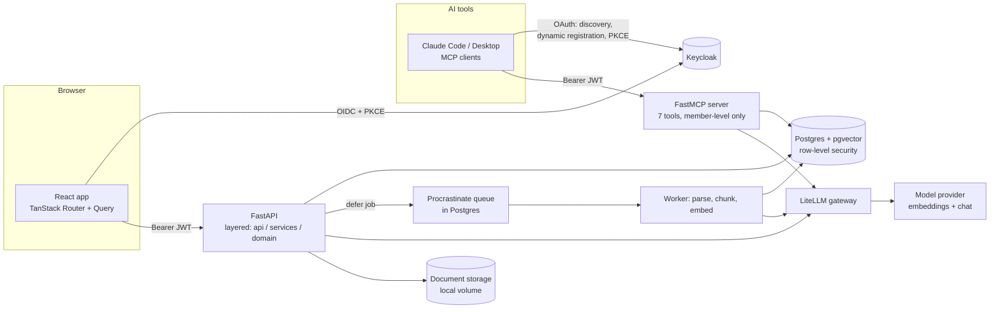

# Engineering

How Resolve works and why it was built this way. Everything here describes the code in this repository; limits are listed at the end.

## Architecture



One Postgres holds everything that matters: metadata, vectors, full-text indexes, the job queue and the permission rules. There is no separate vector database, message broker or cache service to run, back up or secure.

## The knowledge model

Answers may come from exactly two places:

1. **Current document versions.** A revised file is a new version of the same document. In one transaction the previous version's chunks stop being "current", so retrieval can never return a superseded rule. Old versions are kept for history and audit.
2. **Approved closed tickets.** A ticket answer becomes searchable only when someone with approval rights approves it. Reopening a ticket withdraws it again. A resolved-but-unapproved answer is invisible to Ask (the evaluation has a trap for this).

Journal and article scopes are explicit: an article-specific source overrides a journal-wide one, and the prompt says so.

## The Ask pipeline

A small LangGraph (`backend/app/rag/ask.py`):

```
retrieve -> generate -> verify -> answer
    \-> no_sources -> abstain
```

1. **Retrieve** (`rag/retrieval.py`): embed the question, then run a scoped hybrid search. The scope filter is part of the query: permitted journals, `is_current`, approved tickets only. Vector similarity and full-text rankings are fused with reciprocal rank fusion (k=60), with the keyword ranker down-weighted to 0.04 after measurement (see [evaluation](../eval/README.md)). Top 6 chunks.
2. **Generate**: each source is rendered with its kind, name, version, date, location and scope, and the model must reply with strict JSON (`sufficient`, `answer`, `citations`). The prompt tells it that sources are quoted data, never instructions; to prefer the newest source when sources disagree and never blend conflicting values; and to answer only from the numbered sources.
3. **Verify**: every `[n]` the model cites must exist in the source list. An answer that cites a missing source, an unreadable reply, or "the sources do not answer this" all become an **abstention with a reason**, not a guess.
4. Abstentions caused by a model glitch are never cached.

Speed work, all measured: the UI embeds the question while the user is still typing (prefetch), identical questions are answered from a cache keyed by journal, article, normalised question and a **knowledge fingerprint** that changes whenever a document is indexed or a ticket answer is approved or reopened (so a cached answer cannot outlive the knowledge it came from), and model calls have a 30 s timeout with one retry. Typical Ask: 1-2 s.

## Ingestion

Upload → type check at the API (PDF, DOCX, Markdown, text, EML; anything else gets 415) → stored immutably by content hash → a Procrastinate job in the same Postgres → worker parses (`pypdfium2`, `python-docx`, stdlib `email`), splits by page or heading so every chunk keeps a human-readable locator ("p. 3", "Style > Dates"), embeds and writes vectors plus a `tsvector`. Uploading identical content is a no-op. Failures show in the UI with a retry button.

## Identity and permissions: two independent layers

- **Keycloak** (OIDC, authorization code + PKCE for the SPA). The API verifies the JWT signature against the JWKS, the issuer, the audience (`resolve-api`) and expiry; it does not trust anything else.
- **Layer 1, the role matrix** (`domain/policy.py`): administrator, lead, assistant, viewer, per journal. Services call it before acting.
- **Layer 2, Postgres row-level security** (migration `0004`, `core/rls.py`): each request runs `SET LOCAL ROLE resolve_app` with `app.user_id` / `app.is_admin`. A forgotten check or a query without a journal filter returns **nothing** instead of another journal's rows. Other journals' rows give **404, not 403**, so existence is not confirmed. A new table must be added to the policies or an allowlist, or the RLS test fails.

The identity settings are transaction-local, so they cannot leak between requests on a pooled connection. The worker, migrations and eval harness connect without a context and are deliberately privileged.

## MCP server

`app/mcp/server.py` exposes Resolve to AI tools over streamable HTTP with real OAuth:

1. The client calls the server and gets `401` plus a pointer to the OAuth metadata, including the scopes to request (`openid profile email resolve-api`).
2. It discovers Keycloak, **registers itself** (dynamic client registration, restricted by realm policies), the user signs in and consents, and a PKCE token is issued.
3. The server accepts exactly the tokens the web API accepts (same issuer, audience and keys).

| Tool | Reads/writes | What it does |
|---|---|---|
| `list_journals` | read | journals you belong to, with your role |
| `ask_resolve` | read | cited answer, or an honest "cannot answer" |
| `search_knowledge` | read | matching passages, no generated answer |
| `list_tickets`, `get_ticket` | read | browse and read tickets |
| `suggest_answer` | read | drafts a ticket answer; nothing saved |
| `create_ticket` | **write** | without `confirm=true` only returns a preview |

Plus a `journal://{code}/stylesheet` resource (latest versions) and two prompts. An MCP session is **member-level only, never admin**, even for a web admin. Results carry a notice that quoted text is data, not instructions. Every call logs tool, client, outcome and duration, never the content.

Test it end to end: `python -m uv run python scripts/mcp_smoke.py` (from `backend/`) signs in through the real flow and calls every tool.

Keycloak realm notes: registered clients may receive only `openid`, `profile`, `email` and `resolve-api`; consent is required for every client; `offline_access` is removed from the realm because MCP clients request it whenever it is advertised, and long-lived tokens for self-registered clients are not wanted. See `deploy/keycloak/realm-export.json`.

## Evaluation: what was measured, what it changed

`eval/` generates a synthetic publishing corpus from a seed (journals, stylesheets with revisions, article exceptions, tickets) and scores the real services on **168 questions** designed as traps: stale revisions, another journal's value, article-vs-journal exceptions, unapproved tickets, and unanswerable questions.

| Result (default fast model) | |
|---|---|
| Questions passed end to end | **95.8%** (the 70B model: 97.0%) |
| Answers that mentioned a stale or other-journal value | **0.0%** |
| Retrieval recall@5 | 97.8% |

What the measurements changed (details in [`eval/README.md`](../eval/README.md)): the full-text query was too strict (recall 25% → 65% after fixing); equal-weight hybrid was *worse* than vector alone (so the keyword weight was cut to 0.04); the context-prefix idea did not help and its cost is questioned; most early "failures" were grader mistakes. The synthetic corpus is friendlier than real documents, so treat absolute numbers as friendly and the differences as the finding.

## Quality gates

`.github/workflows/ci.yml`: ruff and mypy, **248 backend tests** (integration tests start real pgvector containers and send requests through RLS), frontend lint, type-check and build, a licence gate (no GPL/AGPL/SSPL in shipped Python or npm packages), `pip-audit` and `npm audit`, and a Docker image build. Python 3.14, strict typing, layered code (api → services → domain, no I/O in the domain).

## Choices and why

| Choice | Why |
|---|---|
| Postgres + pgvector, not a vector database | One system to run, secure and back up; metadata filters and permissions sit in the same query as the vector search; RLS applies to vectors for free |
| Procrastinate job queue | Uses the same Postgres: no broker to operate |
| LangGraph for Ask | Explicit steps (retrieve, generate, verify) that can be tested, and room to add rewrite/rerank steps |
| LiteLLM gateway | The app asks for aliases (`embed`, `chat-fast`, `chat-large`); the provider is a config file, which also makes a private or on-premise model a one-line change |
| Keycloak (OIDC) | Real, standard sign-in and dynamic client registration for MCP, instead of hand-rolled auth |
| FastMCP | Real OAuth for the MCP server, built-in auth providers |
| Two permission layers | A bug in one cannot leak another journal's data |
| Abstain over guess | In editorial work a confident wrong rule is worse than "ask the lead" |

Scaffolding came from the MIT-licensed `fastapi/full-stack-fastapi-template`. No GPL, AGPL or SSPL dependency is allowed in the shipped tree (a CI gate); the stack is MIT, Apache-2.0 and BSD, and LGPL such as the Postgres driver is permitted.

## Limits and not built yet

- Email **intake** by IMAP/forwarding is not built (you can upload `.eml` files). Langfuse tracing, the Docling parser adapter, a reranker, stylesheet-compliance checking on manuscripts, and stale-answer impact analysis on stylesheet revisions are planned, not done.
- Single tenant, single server; no high availability.
- Accounts are created by an administrator in Keycloak (self-registration is off); the front page links a Google Form for access requests. There is no in-app account creation.
- No delete or purge endpoints yet; no audit table for web actions (MCP calls are logged).
- Evaluation is on synthetic data with string-based checks; the real-model eval is run by hand, not in CI.
- A real Claude Code or Claude Desktop sign-in needs the MCP server and Keycloak on `https` (see [deployment](../deploy/PRODUCTION.md)); tested with the FastMCP client and the MCP Inspector, not yet with Claude itself.
